# Architecture

The editable diagram source is [architecture.mmd](architecture.mmd). One event
history serves the local analyst interface, GIS exports and an independent client.

```mermaid
flowchart LR
  A[Permitted monthly RGBA imagery and source UDMs] --> B[Native grid, source hashes and validity]
  B --> C[Image-only anchor and accepted-reference registration QA]
  C --> D[482050-parameter footprint and boundary U-Net]
  D --> E[Causal site birth and fixed image-derived geometry]
  C --> F[Usability, elapsed time and seasonal reference]
  E --> G[Shared persistent raw proposals]
  F --> G
  G --> H[78-value available-prefix event features]
  F --> H
  H --> I[Learned event compatibility gate]
  H --> J[Paired no-quality-input gate]
  G --> K[Ordinary proposal-tracking baseline]
  I --> L[Proposed, confirmed, reviewed or retracted revisions]
  J --> L
  K --> L
  L --> M[Append-only DuckDB ledger and immutable snapshots]
  M --> N[Typed area, interval and snapshot API or CLI]
  N --> O[Complete-area analyst evidence workbench]
  N --> P[GeoJSON, GeoParquet and independent consumer]
  D --> R[Native source-linked probability and validity GeoTIFFs]
  T[Five training regions and two development regions] -. labels and calibration .-> D
  T -. physical-compatibility supervision .-> I
  T -. identical examples and budget .-> J
  Q[Three complete confirmation regions] -. frozen evaluation only .-> V[Event, delay, timing, duplicate and false-alert metrics]
  L --> V
  X[Other common-backbone temporal baselines] --> V
```

## Source evidence and geometry

The SpaceNet 7 adapter retains native CRS, affine transform, resolution, bands,
source month intervals, hashes and explicit RGB/alpha/UDM validity. Registration
compares image evidence against an immutable usable anchor and accepted
references, with bounded cumulative offset spread. It neither aligns images to
building labels nor converts a registration rejection into a cloud or absence mask.

The U-Net has 482,050 parameters. Its current spatial-v2 revision uses 2× internal
interpolation, then returns probabilities to the original image grid. That model
operation increases no source resolution. Candidate geometry is image-derived
and frozen at causal discovery. Later images may add candidates but cannot grow
old sites using future evidence. Confirmation labels cannot enter this path.

## Proposal lifecycle and learned gate

`proposal_tracking`, `observation_gate` and `gate_no_quality` share the same raw
decoder: occupancy threshold 0.55, two usable supports and at least 20 days of
dwell, plus the common gap/revision policy. The first opposite support creates a
proposal. Eligibility after persistence allows the learned gate to confirm it.
Low compatibility retains the proposed identity for later observations; a raw
correction retracts it. Score jitter does not repeatedly confirm the same event.

The gate receives 78 values from available current/pre-change/post-change
features and direction, dwell, margin and area context. The paired ablation
zeroes the declared quality/context covariates after train-only standardization.
Both models retain the same hard usability masks, proposals, examples and budget.
They learn compatibility with matched physical annotations, not legal truth,
physical causes, precise event dates or a guaranteed timely warning. See
[event-gate.md](event-gate.md) for the complete feature and label contract.

The earlier masked GRU occupancy model, its ablation, a WATCH LSTM architecture
adaptation, pairwise/tracking, smoothing, HMM, temporal embedding distance and a
retrospective SN7 adaptation remain controlled comparisons over the common
backbone. The retrospective method uses future evidence and its detection
availability includes the complete sequence. It cannot claim online warning.

## Revision and availability semantics

Missing or registration-rejected observations cannot become evidence of absence.
Initial usable inventory is distinct from a supported subsequent change. Physical
reference supervision uses at least 80% building coverage for presence, at most
20% for absence, an unknown middle band, and at least 80% source validity. An ID
change alone cannot establish removal. Duplicate reference grouping is bounded
and audited.

Acquisition support, known or assumed image availability, and ledger record time
are separate. Original image publication dates are unknown in this study, so
month-end availability is an explicit retrospective assumption. The current
adapter requires acquisition order with monotonic availability and rejects
out-of-order publication until replay by availability is implemented.

Every revision retains source identities, quality diagnostics, model identity and
timing support. DuckDB appends revisions; existing snapshot tokens replay the
same historical answer. The public API, exported data and second consumer share
that contract. Model-confirmed and reviewed remain different states.

## Evaluation boundary

Models, calibration, global thresholds, source/feature/truth bytes and
consequential code are frozen before confirmation scoring. Event metrics use
one-to-one class/geometry/time matching, a common 62-day detection horizon,
measured delay, false alerts per area-time and retraction/duplicate costs.
Region-level uncertainty uses three complete confirmation regions. Support-interval
containment is not coverage of a known physical construction date.

**Current status:** the [frozen held-out comparison](results-v2.md) failed geographic
transfer. This detector is not analyst-ready. The diagram describes implemented
computation and contracts; it does not establish a quality-input benefit.
