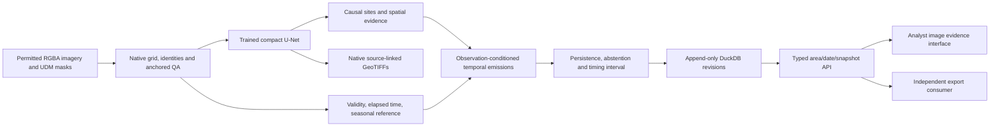

# Architecture

The editable source is [architecture.mmd](architecture.mmd). The same core exports
an event history for both the local analyst interface and an independent consumer.

The spatial model never sees confirmation labels. Image-only candidate geometry is
fixed at discovery. Missing or registration-rejected observations cannot update
the temporal state or become absence evidence. The decoder distinguishes inventory
present in the first usable image from a supported subsequent addition.

Acquisition time, assumed/known availability and ledger record time are distinct.
The current import workflow supports acquisition-ordered sequences with monotonic
availability. Out-of-order publication is rejected until availability-order replay
is implemented. Historical answers use immutable ledger snapshot tokens.

Retrospective SN7 mean-refinement uses future evidence and is named and evaluated
separately. Its detection availability includes the full sequence. Online methods
are tested under future extension and edits without rewriting earlier answers.
