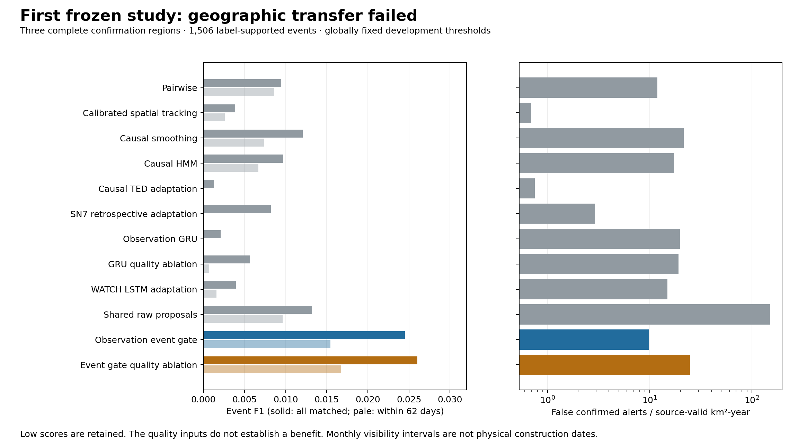
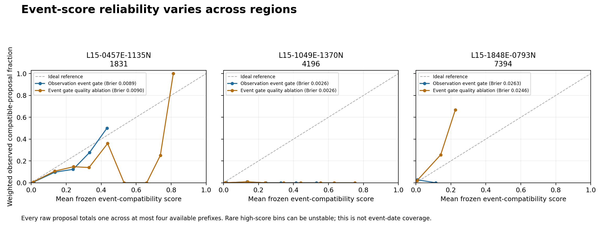

# Confirmation-v2: failed geographic transfer

**The current learned detector is not analyst-ready.** In three complete held-out
regions, the observation-quality event gate matched 27 of 698 confirmed alerts,
with 671 false alerts and 1,479 missed truth events. Precision was 0.03868,
recall 0.01793 and event F1 0.02450. At the common 62-day horizon, it matched only
17 events and F1 fell to 0.01543. These are failed geographic-transfer results,
not a successful deployment or proof of a new quality-aware method.

The no-quality gate had higher pooled ordinary and timely F1, while issuing more
false alerts. Quality inputs reduced alert volume and increased precision at the
frozen operating points, but lost additional true events. That tradeoff does not
establish an overall benefit from learned quality inputs. The retained software,
contracts and executed checks are useful research artifacts; they do not make
the detector reliable for planning or environmental decisions.

## Frozen experiment and evidence

The study used five training and two development regions, with three complete
confirmation sequences. Global development calibration/thresholds, weights,
source/feature/truth bytes and consequential code were frozen before confirmation
scoring. The format is full-freeze-v3; the study artifact is
[freeze-v2.json](../artifacts/freeze-v2.json). No model, threshold, truth target or
metric was tuned after this confirmation result. Earlier weak version-1 models
and development evidence remain preserved, rather than being replaced by this
run.

The source reports are the
[complete twelve-method comparison](../artifacts/confirmation-v2/comparison.json),
[held-out gate reliability](../artifacts/gate-reliability-v2.json),
[stress controls](../artifacts/stress-v2.json) and
[metric definitions](metrics.md). Models are spatial-v2, temporal-v2 and
event-gate-v1 under experiment-v4 and calibration-v2. The freeze timestamp is
`2026-10-29T07:56:33.956700+00:00`.

Scores below are fractions, not percentages. TP is a one-to-one matched event,
FP an unmatched confirmed alert, and FN a missed supported truth event.
Ordinary matching requires the same change class, geodesic footprint IoU >= 0.25
and first-support proxies within 93 days. Timing padding cannot manufacture
eligibility. The 62-day column additionally limits detection delay. The target is
monthly label-supported visibility, not known physical construction dates.

## Pooled comparison across all three regions

| Method | TP / FP / FN | Precision | Recall | Event F1 | TP within 62 d | F1 within 62 d | False alerts / source-valid km²-year |
| --- | ---: | ---: | ---: | ---: | ---: | ---: | ---: |
| `pairwise` | 11 / 812 / 1,495 | 0.01337 | 0.00730 | 0.00945 | 10 | 0.00859 | 11.938 |
| `spatial_tracking` | 3 / 47 / 1,503 | 0.06000 | 0.00199 | 0.00386 | 2 | 0.00257 | 0.691 |
| `smoothing` | 18 / 1,461 / 1,488 | 0.01217 | 0.01195 | 0.01206 | 11 | 0.00737 | 21.479 |
| `hmm` | 13 / 1,175 / 1,493 | 0.01094 | 0.00863 | 0.00965 | 9 | 0.00668 | 17.274 |
| `ted` | 1 / 51 / 1,505 | 0.01923 | 0.00066 | 0.00128 | 0 | 0.00000 | 0.750 |
| `sn7_retrospective` | 7 / 199 / 1,499 | 0.03398 | 0.00465 | 0.00818 | 0 | 0.00000 | 2.926 |
| `observation` | 3 / 1,342 / 1,503 | 0.00223 | 0.00199 | 0.00210 | 0 | 0.00000 | 19.729 |
| `no_quality` | 8 / 1,300 / 1,498 | 0.00612 | 0.00531 | 0.00569 | 1 | 0.00071 | 19.112 |
| `watch_lstm` | 5 / 1,018 / 1,501 | 0.00489 | 0.00332 | 0.00395 | 2 | 0.00158 | 14.966 |
| `proposal_tracking` | 78 / 10,237 / 1,428 | 0.00756 | 0.05179 | 0.01320 | 57 | 0.00964 | 150.499 |
| `observation_gate` | 27 / 671 / 1,479 | 0.03868 | 0.01793 | 0.02450 | 17 | 0.01543 | 9.865 |
| `gate_no_quality` | 42 / 1,679 / 1,464 | 0.02440 | 0.02789 | 0.02603 | 27 | 0.01673 | 24.684 |

The SN7 row is explicitly retrospective, uses full-sequence availability and is
a temporal adaptation over this local backbone. WATCH is an architecture/task
adaptation. Neither row reproduces its published full system or original task.
The three proposal methods share raw candidates, geometry and persistence policy.

[Editable comparison figure](figures-v2-complete/confirmation-v2.svg).

Relative to raw proposal tracking, the quality gate reduces false alerts from
10,237 to 671 but also reduces matches from 78 to 27. The no-quality gate retains
42 matches with 1,679 false alerts. A better F1 than a very weak raw baseline is
insufficient evidence of usable performance. No positive future result is promised.

## Complete-region event results

Identifiers below abbreviate the full public AOI IDs; linked files retain all
source identities and metrics. No attractive crop substitutes for a full region.

| Region and method | Truth events | TP / FP / FN | Precision | Recall | Event F1 | TP within 62 d | F1 within 62 d |
| --- | ---: | ---: | ---: | ---: | ---: | ---: | ---: |
| [0457](../artifacts/confirmation-v2/observation_gate/L15-0457E-1135N_1831_3648_13.json) · `observation_gate` | 615 | 26 / 299 / 589 | 0.08000 | 0.04228 | 0.05532 | 16 | 0.03404 |
| [0457](../artifacts/confirmation-v2/gate_no_quality/L15-0457E-1135N_1831_3648_13.json) · `gate_no_quality` | 615 | 35 / 888 / 580 | 0.03792 | 0.05691 | 0.04551 | 21 | 0.02731 |
| [0457](../artifacts/confirmation-v2/proposal_tracking/L15-0457E-1135N_1831_3648_13.json) · `proposal_tracking` | 615 | 55 / 5,942 / 560 | 0.00917 | 0.08943 | 0.01664 | 43 | 0.01301 |
| [1049](../artifacts/confirmation-v2/observation_gate/L15-1049E-1370N_4196_2710_13.json) · `observation_gate` | 31 | 1 / 363 / 30 | 0.00275 | 0.03226 | 0.00506 | 1 | 0.00506 |
| [1049](../artifacts/confirmation-v2/gate_no_quality/L15-1049E-1370N_4196_2710_13.json) · `gate_no_quality` | 31 | 1 / 699 / 30 | 0.00143 | 0.03226 | 0.00274 | 1 | 0.00274 |
| [1049](../artifacts/confirmation-v2/proposal_tracking/L15-1049E-1370N_4196_2710_13.json) · `proposal_tracking` | 31 | 3 / 3,564 / 28 | 0.00084 | 0.09677 | 0.00167 | 2 | 0.00111 |
| [1848](../artifacts/confirmation-v2/observation_gate/L15-1848E-0793N_7394_5018_13.json) · `observation_gate` | 860 | 0 / 9 / 860 | 0.00000 | 0.00000 | 0.00000 | 0 | 0.00000 |
| [1848](../artifacts/confirmation-v2/gate_no_quality/L15-1848E-0793N_7394_5018_13.json) · `gate_no_quality` | 860 | 6 / 92 / 854 | 0.06122 | 0.00698 | 0.01253 | 5 | 0.01044 |
| [1848](../artifacts/confirmation-v2/proposal_tracking/L15-1848E-0793N_7394_5018_13.json) · `proposal_tracking` | 860 | 20 / 731 / 840 | 0.02663 | 0.02326 | 0.02483 | 12 | 0.01490 |

## Source coverage, exclusions and the proposal ceiling

Exposure is measured from actual masks and acquisition durations. The percentage
columns divide valid or model-usable area-time by total AOI calendar area-time.
A rejected frame may already have no source-valid area, so rejected-frame counts
are not an additional independent area exclusion.

| Region | Native months | Area km² | Source-valid km²-years | Source-valid area-time | Model-usable area-time | Registration/support-rejected frames | Sites | Truth events with candidate IoU >= 0.25 |
| --- | ---: | ---: | ---: | ---: | ---: | ---: | ---: | ---: |
| 0457 | 24 | 21.187 | 34.960 | 82.56% | 82.56% | 4 | 7,759 | 150 / 615 (24.39%) |
| 1049 | 25 | 9.135 | 18.933 | 99.47% | 99.47% | 0 | 7,458 | 9 / 31 (29.03%) |
| 1848 | 25 | 15.025 | 14.127 | 45.13% | 43.70% | 13 | 2,343 | 232 / 860 (26.98%) |

Only 391 of 1,506 truth events have a common candidate at the stated geometry
threshold: 25.96% before temporal matching or detection-delay restrictions.
This exposes a severe upstream recall limit. It does not excuse misses among
covered sites: region 1848 has 232 geometrically covered truth events, yet the
quality gate matches none. Region 1049 has nearly complete source-valid
area-time and still produces 363 false alerts for one quality-gate match.

Truth audits include reference sites with no events and masked/ambiguous support,
not only successful transitions. Reference-frame counts below can involve
overlapping footprints; they are not independent imagery observations.

| Region | Reference sites | Source-unusable reference-frames | Ambiguous coverage frames | References with zero events | Pending insufficient support | Duplicate references merged |
| --- | ---: | ---: | ---: | ---: | ---: | ---: |
| [0457 audit](../artifacts/confirmation-v2/L15-0457E-1135N_1831_3648_13-truth-audit.json) | 14,033 | 58,244 | 69 | 13,468 | 18 | 2 |
| [1049 audit](../artifacts/confirmation-v2/L15-1049E-1370N_4196_2710_13-truth-audit.json) | 721 | 138 | 2 | 691 | 3 | 0 |
| [1848 audit](../artifacts/confirmation-v2/L15-1848E-0793N_7394_5018_13-truth-audit.json) | 1,531 | 21,555 | 0 | 670 | 18 | 9 |

Physical truth requires >=80% source-valid reference area, then >=80% any-building
coverage among that valid portion for presence or <=20% for absence. The middle
band is unknown. Two usable supports establish a transition. An ID reassignment
alone cannot establish demolition. Duplicate grouping is bounded against all
members; full identities/geometries/timing remain in the audit.

## Timing support must be read beside recall

This table describes the quality gate's matched subset only. Containment means
containing the entire **label interval**, not a physical-date confidence guarantee.
Undefined cells in region 1848 represent zero matches, not perfect timing.

| Region | Matched / all truth | Raw label-interval containment | Expanded containment | Median raw / expanded interval days | Median delay days | Delay p90 days |
| --- | ---: | ---: | ---: | ---: | ---: | ---: |
| 0457 | 26 / 615 | 0.6154 | 0.7308 | 61.0 / 123.0 | 61.0 | 121.0 |
| 1049 | 1 / 31 | 0.0000 | 0.0000 | 61.0 / 123.0 | -31.0 | -31.0 |
| 1848 | 0 / 860 | undefined | undefined | undefined / undefined | undefined | undefined |

The -31-day delay in region 1049 is one early interval-proxy match, not proof of
prediction before construction. Original publication dates are unknown, and
availability was assumed at month end. Low recall cannot be repaired by widening
only the timing intervals of the few matched alerts.

## False alerts and corrections

The quality gate produces 9.865 false confirmed alerts per source-valid km²-year,
versus 24.684 for its ablation and 150.499 for raw proposal tracking. Its regional
rates are 8.553, 19.173 and 0.637. The last low rate accompanies zero matches and
must not be read as useful quiet monitoring.

Of the quality gate's 698 ever-confirmed IDs, 131 are later retracted: 33 in 0457,
98 in 1049 and none in 1848. That includes one matched event and 130 false alerts.
Retraction does not erase an issued false alert from the score. The no-quality
gate has 229 confirmed-then-retracted IDs; raw proposal tracking has 2,427. No
same-truth duplicate confirmation was counted for these three methods. The
report's illustrative cost weights are dimensionless sensitivity assumptions,
not measured analyst time, money or demonstrated business value.

## Geographic uncertainty

Bootstrap intervals resample the three complete regions with replacement 2,000
times, seed 2901. Every interval below has 2,000 defined resamples. With only
three regions, these discrete percentile intervals are unstable and cannot
establish broad transfer or a statistically reliable quality-input advantage.

| Metric | Quality gate 95% region percentile interval | No-quality gate interval |
| --- | ---: | ---: |
| `event.precision` | [0.00000, 0.08000] | [0.00143, 0.06122] |
| `event.recall` | [0.00000, 0.04228] | [0.00698, 0.05691] |
| `event.f1` | [0.00000, 0.05532] | [0.00274, 0.04551] |
| `within_62_days.f1` | [0.00000, 0.03404] | [0.00274, 0.02731] |
| `false_confirmed_alerts_per_source_valid_km2_year` | [0.63708, 19.17273] | [6.51235, 36.91940] |

## Held-out compatibility calibration

The following assessment performs no fitting. It scores all raw eligible
proposals using at most four observed prefixes before retraction, with unit total
mass per proposal and frozen development transforms. It is not calibration of
only accepted alerts under repeated gate decisions, nor of omitted buildings.
The oracle baseline uses held-out prevalence diagnostically and is not deployable.

| Region | Raw proposal mass | Prefix rows | Compatible proportion | Quality-gate Brier | No-quality Brier | Constant-prevalence oracle Brier |
| --- | ---: | ---: | ---: | ---: | ---: | ---: |
| 0457 | 5,997 | 20,252 | 0.009171 | 0.008928 | 0.008968 | 0.009087 |
| 1049 | 3,567 | 11,622 | 0.000841 | 0.002555 | 0.002590 | 0.000840 |
| 1848 | 751 | 2,489 | 0.026631 | 0.026283 | 0.024577 | 0.025922 |

Brier is mean squared score error. In region 1049, the quality gate's 0.002555
error is about three times the 0.000840 prevalence-oracle error, despite a small
absolute number. Region 1848 favors the no-quality gate by Brier; the first two
regions slightly favor quality by Brier. These mixed conditional diagnostics do
not reverse the failed end-to-end event result or establish arbitrary-shift
calibration.

[Editable calibration figure](figures-v2-complete/event-calibration-v2.svg). Rare bins have
little proposal mass; see the original bin denominators before interpreting them.

## Stress and online-answer checks

The [stress artifact](../artifacts/stress-v2.json) retains all cases. For the
quality gate, removing four observations changes matches from 26 to 18 in 0457,
leaves one in 1049 and leaves none in 1848. The first region's timely matches
fall from 16 to 14. Temporal controls condition on the already fixed candidate
set and do not measure additional candidate loss caused by missing imagery.

Static-evidence/calendar and all-missing-observation controls produce no confirmed
alerts for all three proposal methods in all three regions. Their empty metric
denominators remain undefined. These are controlled perturbations of real data,
not newly observed support and not evidence of broad robustness.

All three injected three-pixel image shifts are rejected by registration QA.
Brightness factors 0.7 and 1.3 alter one reference frame's spatial Dice:
0457 changes from 0.5463 to 0.4544/0.5704; 1049 from 0.0863 to
0.0482/0.2181; 1848 from 0.4338 to 0.3768/0.4141. One-frame radiometric
sensitivity is not a complete seasonal simulation. Natural source sequences and
all exclusions remain in the ordinary-region reports.

The [gate-prefix receipt](../artifacts/verification-v2/online-gates-invariance.json)
passes exact event-revision prefix and future-feature/mask edit checks for
`proposal_tracking`, `observation_gate` and `gate_no_quality` in all three real
regions, at 12-observation prefixes. Labels were not read for those checks.
This is a scoped pass, not an assertion that every method passed strict invariance.

### Original study and separately versioned numerical repair

The original frozen-study implementation has a documented strict legacy GRU
`no_quality` prefix failure. Its
[recorded diagnostic](../artifacts/verification-v2/invariance-no-quality-diagnosis.json)
finds exact prefix features and the same 764 revision rows, but one confidence
field differs by 1.19e-7 when the terminal site batch has a different shape
(maximum internal score difference 3.58e-7). That historical failure remains part
of version-2 evidence. Reproducing this original experiment requires the
preserved source commit `bd33082`, rather than silently running newer code under
its freeze manifest.

A separate processing-v3 repair introduces numerical protocol
`fixed512-site-batch-v2`. The occupancy predictor pads its final site batch to
512 using zero features and unavailable masks, then trims outputs back to the
actual site count. Explicit non-512 batch sizes are rejected. This changes no
trained architecture, weights, calibration, thresholds, truth protocol or event
gate. The processing revision includes code identity, so repaired histories have
a new runtime/model revision rather than relabeling old answers.

The recorded repair receipts, `padding-repair-summary.json` and
`PATCHED-RESULTS.md`, report 18 focused tests and nine exact
learned-method/confirmation-region prefix and future-edit checks. Those nine
checks cover `observation`, `no_quality` and `watch_lstm` across all three regions,
including calibrated scores and every historical revision field. Label arrays
were not read, no model was refitted, and native candidate/feature proof was
reused only after verifying its recorded bytes. Original freeze, weights,
calibration and configuration remain unchanged.

Under a common dispatcher identity used only for numerical comparison, repaired
versus original full-sequence inference preserves event IDs, states, decisions,
geometry, source identities, times and revision counts in all nine combinations.
Internal scores change by at most 8.34e-7; one recorded full-sequence confidence
changes by 1.19e-7. Those facts do not rewrite the original confidence or improve
its failed scientific result.

These passes are scoped to the source hashes in the repair receipts. At this
documentation update, `temporal.py` matches its recorded repair hash, while the
live dispatcher has later changes beyond the recorded `pipeline.py` hash.
Consequently, this document does not claim that every current dispatcher version
or all twelve comparison methods were reverified. The original gate-only receipt
and the separately versioned occupancy repair remain distinct evidence.

## Software checks and release status

The frozen-study build's local correctness suite reports 77 passing tests, with warnings retained in
its execution log. That verifies checked contracts and failure paths, not model
accuracy. The independent
[wheel-install receipt](../artifacts/verification-v2/independent-install.json)
loads the installed package from a fresh environment and executes three changed
public cropped-input/prefix runs. The
[actual loopback API receipt](../artifacts/verification-v2/independent-api.json)
returns 19 versus 43 records for different areas, zero for early/outside queries,
identical snapshot replay and independent GeoJSON/GeoParquet readback. The
[standard-library second consumer](../artifacts/verification-v2/second-consumer.json)
reads exported records without the map. Those counts include model proposals;
they are not validated counts of physical changes. A cropped wheel check is
separate from final public clean-clone, CI and release-download verification.

The [independent pre-freeze review](../artifacts/verification-v2/independent-review.md)
cleared the reviewed correctness issues before scoring; it explicitly did not
establish scientific success. The subsequent
[v0.1.0-research release](https://github.com/nazeeh111/TerraDelta/releases/tag/v0.1.0-research)
preserves this failed study. Its
[public delivery receipt](../artifacts/verification-v3/public-release-v1.json)
records successful remote CI, verified downloads of all 17 assets and a cold
public-only replay of the complete history, snapshots and source imagery.
These checks establish research delivery, not analyst-ready detection.

A further scientific revision requires a declared new method/experiment and
fresh complete geographic confirmation data, since these regions have now been
examined. The later [experiment-v8](../configs/experiment-v8.json) declares nine
training, four development and three fresh confirmation regions. Its new fits,
development calibration and
[independently audited freeze](../artifacts/verification-v3/confirmation-boundary-v3.md)
are complete, but fresh confirmation remains deliberately unscored while
development checks address weak proposals. The retained spatial checkpoint has
an explicit [fit recovery audit](../artifacts/verification-v3/spatial-v3-fit-audit.md),
including the original failed source-integrity check. Neither preparation nor
the numerical repair establishes improved event performance. The
[current research status](../README.md) distinguishes that unfinished revision
from this released result; both earlier negative outcomes remain in the record.
